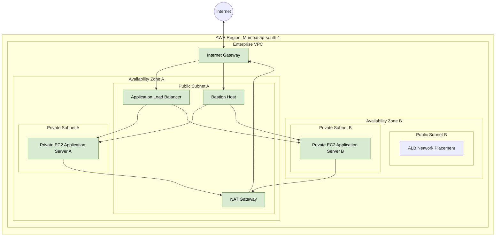

# AWS Enterprise Cloud Infrastructure Architecture

## 1. Project Overview

This project demonstrates the implementation of an enterprise-style AWS cloud infrastructure in the Mumbai region (`ap-south-1`).

The infrastructure uses a custom VPC, public and private subnets across two Availability Zones, an Internet Gateway, NAT Gateway, Bastion Host, private EC2 application servers, and an Application Load Balancer.

The architecture documentation distinguishes implemented resources from planned improvements.

## 2. AWS Architecture Diagram

The following diagram represents the current implemented infrastructure and its network traffic flow.

## 3. Infrastructure Components

| Component | Purpose | Status |
|---|---|---|
| Custom VPC | Isolated network environment | Implemented |
| Public Subnets | Host internet-facing resources | Implemented |
| Private Subnets | Host application servers | Implemented |
| Internet Gateway | Internet connectivity for public resources | Implemented |
| NAT Gateway | Outbound internet access for private resources | Implemented |
| Bastion Host | Administrative SSH access | Implemented |
| EC2 Application Servers | Run the Apache web application | Implemented |
| Application Load Balancer | Distribute HTTP requests | Implemented and tested |
| Launch Template | Define EC2 launch configuration | Version 2 created |
| Auto Scaling Group | Automatically manage EC2 capacity | Pending configuration update |
| Amazon RDS MySQL | Managed relational database | Planned |
| Amazon EFS | Shared file storage | Planned |
| Amazon S3 | Object storage and backups | Planned |
| Amazon CloudWatch | Monitoring and alarms | Planned |
| AWS CloudTrail | API activity auditing | Planned |

## 4. Network Design

### Public Subnets

Public subnets contain internet-facing infrastructure, including the Bastion Host, NAT Gateway, and Application Load Balancer.

Their route table provides a route to the Internet Gateway.

### Private Subnets

Private subnets contain application EC2 instances.

They do not require public IP addresses for normal outbound internet access. Their route table uses the NAT Gateway for outbound connectivity.

### Availability Zones

The infrastructure uses two Availability Zones to distribute application resources and improve resilience.

## 5. Application Traffic Flow

1. A user sends an HTTP request.
2. The request reaches the Application Load Balancer.
3. The ALB forwards the request to a healthy registered EC2 application server.
4. The Apache web server processes the request.
5. The application response returns through the load balancer to the user.

## 6. Administrative Access Flow

1. An administrator connects to the Bastion Host using SSH.
2. The Bastion Host provides controlled access to private EC2 instances.
3. SSH agent forwarding is used for administrative access to the private application servers.

## 7. Security Design

- Use separate public and private subnets.
- Restrict SSH access to the Bastion Host to the administrator's permitted IP address.
- Keep application instances in private subnets.
- Use Security Groups to control network access.
- Avoid exposing private application instances directly to the internet.
- Never commit passwords, private keys, or AWS access credentials.

## 8. Current Implementation Limitations

- Only one NAT Gateway has currently been implemented. This is a potential availability limitation.
- Auto Scaling Group configuration update is pending.
- RDS, EFS, S3, CloudWatch, and CloudTrail integration remain planned.
- Production readiness requires further security, resilience, monitoring, and recovery validation.

## 9. Future Improvements

- Complete and verify Auto Scaling Group configuration.
- Deploy Amazon RDS in private subnets.
- Configure EFS shared storage.
- Integrate S3 for object storage and backups.
- Configure CloudWatch dashboards and alarms.
- Enable CloudTrail auditing.
- Evaluate a multi-NAT design for improved availability.
- Add automated infrastructure deployment using Terraform.

## 10. Project Documentation

- [Project Overview](../README.md)
- [Implementation Documentation](../docs/README.md)
- [Screenshots and Evidence](../screenshots/README.md)
- [Troubleshooting Documentation](../troubleshooting/README.md)
